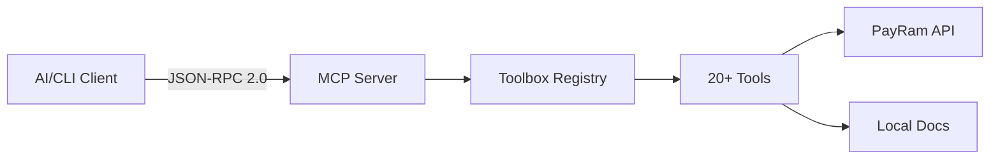

# PayRam Analytics MCP Server

> [!WARNING]
> **Retired.** This analytics MCP server and its agent are no longer maintained. An MCP server built into PayRam itself is replacing them. Do not set up new installs. If you run it today, remove it (steps below).
>
> **Your install will not pick this version up by itself.** The Docker setup (`setup_payram_agent.sh`) runs the chat, MCP and bot programs built into its own image (`PAYRAM_AGENT_*_BIN=/app/...` in `.env`). Its automatic update downloads new versions but never runs them, and it never updates the agent itself. Only a rebuild changes what runs.

## Remove it (recommended)

**Docker install** (`setup_payram_agent.sh`). Run these in the folder where you ran the script. If you set `HOST_AGENT_HOME`, `--env-file` or `RUN_IMAGE`, use your values instead.
```sh
docker rm -f payram-analytics-agent     # stops and removes the container
docker rmi payram-analytics-agent:dev   # removes the image the script built
rm -rf .agent-home .env                 # these hold your PayRam dashboard password, OpenAI key and Telegram bot token in plain text
```
The container ran as root, so some files under `.agent-home` may need `sudo rm -rf .agent-home`.
The script started the container with `docker run --rm -d` and no restart policy. If `docker ps --filter name=payram-analytics-agent` shows nothing, the container is already gone (a reboot or a Docker restart stops it, and Docker then removes it), and you only need to delete the image and the files.

**Started by `setup_payram_agents.sh` from payram-scripts** (`mcp.bin` running on the host). Use `<your PAYRAM_WORK_DIR>/.payraminfo` if you set that variable.
```sh
kill "$(cat ~/.payraminfo/mcp-server.pid)"   # or: pkill -f '.payraminfo/mcp.bin'
rm -f ~/.payraminfo/mcp.bin ~/.payraminfo/mcp.bin.sha256 ~/.payraminfo/mcp.bin.version ~/.payraminfo/mcp-server.pid
```

**Run from a checkout** (`make run-agent`, `make run-mcp`, `make run-app`, `go run ...`): stop it with Ctrl-C in its terminal, or run `pkill -f payram-analytics`.

**Then check that nothing is still listening:** `lsof -nP -iTCP:3333 -iTCP:2358 -iTCP:9900 -sTCP:LISTEN` (on Linux you can use `ss -ltnp | grep -E ':(3333|2358|9900) '`). As a precaution, change the password of the PayRam dashboard account the agent signed in with. If you made an OpenAI key or a Telegram bot just for this agent, revoke them too.

## If you keep it: what this version changes

Get it by rebuilding. Run `git pull` in your checkout, then run `./setup_payram_agent.sh` again. It rebuilds the image from your checkout and writes a new `.env`. Do this only if you choose to keep the agent.

- **A tool call can no longer redirect your PayRam login.** Tools refuse `base_url` with an error. The server sends its token, and any token a caller passes, only to the PayRam URL in its own `PAYRAM_ANALYTICS_BASE_URL`.
- **Everything listens on 127.0.0.1 by default:** the MCP server (3333), the chat API (2358) and the agent (9900). To choose another address, set `MCP_HTTP_ADDR` / `-http`, `CHAT_API_ADDR` / `-addr` or `PAYRAM_AGENT_LISTEN_ADDR`. Any address other than loopback prints a warning at startup.
- **Every `/admin` call needs the admin token**, sent as the `X-MCP-Key: $PAYRAM_AGENT_ADMIN_TOKEN` header. Calls from 127.0.0.1 or a Docker network (172.16.0.0/12) no longer get in without it, and `PAYRAM_AGENT_ADMIN_ALLOWLIST` is ignored. The setup script writes a random token into `.env`. If no token is set, the agent makes one that only its own update check knows.
- **Docker setup:** the container publishes only `127.0.0.1:9900`. Reach the MCP server at `http://127.0.0.1:9900/mcp` and the chat API at `http://127.0.0.1:9900/chat` (ports 3333 and 2358 are no longer published).

## About

A Go-based Model Context Protocol (MCP) server that provides AI assistants with structured access to PayRam's analytics, documentation, and operational data through 20+ specialized tools.

## 📚 Documentation

- **[Complete Tools Documentation](docs/TOOLS_DOCUMENTATION.md)** - Comprehensive guide covering all tools, architecture, examples, and best practices
- **[Quick Reference Guide](docs/TOOLS_QUICK_REFERENCE.md)** - Cheat sheet for fast tool lookups and common patterns
- **[API Reference](docs/API_REFERENCE.md)** - Direct tool API docs with expected inputs and outputs

## Prerequisites
- Go 1.22+

## Authentication

The MCP server supports two authentication modes:

### Option A — Static Bearer Token
```bash
export PAYRAM_ANALYTICS_TOKEN=your_token_here
export PAYRAM_ANALYTICS_BASE_URL=https://api.example.com
```

### Option B — Auto-Login (email + password)
Set these instead and the server will log in automatically, cache the token, and refresh it only when it expires:
```bash
export PAYRAM_ANALYTICS_BASE_URL=https://api.example.com
export USER_EMAIL=admin@example.com
export USER_PASSWORD=secret
# Aliases also accepted:
# PAYRAM_DASHBOARD_USERNAME / PAYRAM_DASHBOARD_PASSWORD
```

Token resolution order per call: **per-call `token` arg → auto-login manager → `PAYRAM_ANALYTICS_TOKEN` env**.

The PayRam URL comes only from `PAYRAM_ANALYTICS_BASE_URL`. Tools refuse a `base_url` argument, so a caller cannot make the server send a token anywhere else.

## Run (stdio)
```sh
make run
```
Send JSON-RPC 2.0 requests over stdin. Example session:

1) Initialize
```json
{"id":1,"method":"initialize","params":{}}
```
2) List tools
```json
{"id":2,"method":"tools/list","params":{}}
```
3) Call the PayRam intro tool
```json
{"id":3,"method":"tools/call","params":{"name":"payram_intro"}}
```

## Run (HTTP)
```sh
make run-mcp  # listens on 127.0.0.1:3333 (set MCP_HTTP_ADDR or -http to change it)
```
Call with a single JSON-RPC request per POST:
```sh
curl -X POST -H "Content-Type: application/json" \
	-d '{"id":1,"method":"tools/list","params":{}}' \
	http://localhost:3333/
```
Health check: `curl http://localhost:3333/health`

## Available Tools (20+)

The server provides tools organized into seven categories:

### 📖 Information & Discovery (4 tools)
- **`payram_intro`** - Platform overview and quick start
- **`payram_docs`** - Search and retrieve documentation (5 actions: search, get_section, list_index, get_doc_by_id, list_docs)
- **`payram_dashboard_helper`** - Guided dashboard workflows (11 topics)
- **`payram_discover_analytics`** - Auto-discover available analytics

### 💳 Payment Operations (4 tools)
- **`payram_payments_summary`** - High-level payment metrics
- **`payram_payment_summary`** - Payment status counts by project
- **`payram_payment_search`** - Advanced payment search with filters
- **`payram_payment_link`** - Create payment links programmatically

### 🔄 Transaction Tracking (2 tools)
- **`payram_recent_transactions`** - Latest transaction activity
- **`payram_transaction_counts`** - Volume metrics by status

### 👥 User Analytics (2 tools)
- **`payram_paying_users`** - Active paying users metrics
- **`payram_user_growth`** - User acquisition trends

### 💰 Financial Analytics (4 tools)
- **`payram_currency_breakdown`** - Distribution by cryptocurrency
- **`payram_deposit_distribution`** - Deposit patterns analysis
- **`payram_daily_stats`** - Daily aggregated statistics
- **`payram_numbers_summary`** - Key metrics snapshot

### 📊 Project Management (2 tools)
- **`payram_projects_list`** - List all projects
- **`payram_projects_summary`** - Per-project analytics

### 🔬 Advanced Analysis (2 tools)
- **`payram_compare_periods`** - Period-over-period comparison
- **`payram_fetch_graph_data`** - Custom graph data with date filtering

> **See [TOOLS_DOCUMENTATION.md](docs/TOOLS_DOCUMENTATION.md) for detailed parameters, examples, and use cases for each tool.**

## Chat orchestrator (UI)
Launch a minimal chat UI that routes tool calls through the MCP server (HTTP mode required):

```sh
# terminal 1
make run-http

# terminal 2
OPENAI_API_KEY=sk-... make run-chat CHAT_PORT=3000 MCP_SERVER_URL=http://localhost:3333/
```

Then open http://localhost:3000/ and ask for a PayRam intro to see the tool call in action.

Environment:
- `OPENAI_API_KEY` (required)
- `OPENAI_MODEL` (default: `gpt-4o-mini`)
- `OPENAI_BASE_URL` (default: `https://api.openai.com/v1`)

## OpenAI-compatible chat API
Expose `/v1/chat/completions` that routes tool calls to the MCP server, with a PayRam system prompt.

```sh
# terminal 1: MCP HTTP
make run-http

# terminal 2: Chat API
CHAT_API_KEY=secret OPENAI_API_KEY=sk-... make run-chat-api CHAT_API_PORT=2358 MCP_SERVER_URL=http://localhost:3333/
```

Call example:
```sh
curl -X POST http://localhost:2358/v1/chat/completions \
	-H "Authorization: Bearer secret" \
	-H "Content-Type: application/json" \
	-d '{
		"model": "gpt-4o-mini",
		"messages": [{"role":"user","content":"List analytics groups"}]
	}'
```

Configuration (.env or env vars):
- `Environment Configuration

Tools that access PayRam APIs require these environment variables:

```bash
export PAYRAM_ANALYTICS_TOKEN=your_bearer_token_here
export PAYRAM_ANALYTICS_BASE_URL=https://api.payram.com
export PAYRAM_DOCS_ROOT=docs/payram-docs  # Optional: custom docs path
export PAYRAM_MCP_DEBUG=true              # Optional: enable debug logging
```

See [Authentication & Configuration](docs/TOOLS_DOCUMENTATION.md#authentication--configuration) for details.

## Architecture



**Key Components:**
- **MCP Server** - Handles JSON-RPC 2.0 requests (`initialize`, `ping`, `tools/list`, `tools/call`)
- **Toolbox** - Registry and dispatcher for all tools
- **Tools** - Individual implementations with `Descriptor()` and `Invoke()` methods
- **Protocol** - MCP request/response structures

See [Architecture Overview](docs/TOOLS_DOCUMENTATION.md#architecture-overview) for detailed flow diagrams.

## Structure
- `main.go`: wires stdin/stdout loop to the MCP server.
- `internal/mcp`: server routing, toolbox, and protocol handling.
- `internal/tools`: individual tool implementations (20+ tools, extensible).
- `internal/protocol`: shared types for requests/responses.
- `docs/`: comprehensive documentation and quick reference guid
## Agent + Docker setup (with optional Telegram add-on)
Use the helper script to generate `.env`, seed secrets, and run the containerized agent (supervisor for chat + MCP):

```sh
./setup_payram_agent.sh [--with-telegram] [--allow-telegram-chat "123,456"] [--env-file my.env] [--no-start]
```

Prompts (core): PayRam base URL, optional OpenAI key.

When `--with-telegram`:
- Prompts for `TELEGRAM_BOT_TOKEN`, optional `TELEGRAM_WEBHOOK_BASE_URL` (leave empty to poll), dashboard username/password, and allowed chat IDs (comma-separated). Values are stored in `${HOST_AGENT_HOME:-$PWD/.agent-home}/state/secrets.json` with `0600` perms and mirrored into `.env` as `TELEGRAM_*`.
- Sets `CHAT_API_BOT_BYPASS_TOKEN` to the Telegram bot token so the bot can call `/v1/chat/completions` without bearer auth.
- Enables the supervised Telegram bot service (inside the agent container) when `TELEGRAM_ENABLED=true`; the bot only responds to chat IDs present in `telegram_allowed_chats`.

Allowlist updates after deploy:
- Run the script again with `--allow-telegram-chat "<chat_id>[,<chat_id2>]"` to append chat IDs to the allowlist in `state/secrets.json`; re-run without `--no-start` to restart the container, or manually restart your Docker container for changes to take effect.

Bot service notes:
- Default Chat API target: `http://127.0.0.1:2358/v1/chat/completions`; override with `TELEGRAM_CHAT_API_URL` if needed.
- Logs are available via the agent admin endpoint: `/admin/logs?component=bot&tail=200`.
- Only long-polling is implemented by default; set `TELEGRAM_WEBHOOK_BASE_URL` to introduce webhook mode later.

Generated `.env` includes defaults for ports (agent `9900`, chat `2358`, MCP `3333`), the update channel, a random `PAYRAM_AGENT_ADMIN_TOKEN` (send it as `X-MCP-Key` on `/admin` calls), and proxying chat via the agent. Only the agent's port is published, on `127.0.0.1:9900`; chat and MCP are reached through it at `/chat` and `/mcp`.

## Structure
- `main.go`: wires stdin/stdout loop to the MCP server.
- `internal/mcp`: server routing, toolbox, and protocol handling.
- `internal/tools`: individual tool implementations (extensible).
- `internal/protocol`: shared types for requests/responses.

## Development
- Format: `make fmt`
- Test (no tests yet, but ensures build succeeds): `make test`

## Updates and releases
- Secrets: set repository secret `PAYRAM_UPDATE_ED25519_PRIVKEY_B64` to the base64-encoded 64-byte Ed25519 private key used to sign manifests (public key is logged during the workflow run).
- Tagging: push tags `vX.Y.Z` for stable and `vX.Y.Z-beta.N` for beta. The release workflow builds linux/amd64 binaries `chat.bin` (from `cmd/chat-api`) and `mcp.bin` (from `cmd/mcp-server`), uploads them as GitHub Release assets, generates `updates/<channel>/manifest.json` + `.sig`, and commits them back to `updates/` on the default branch.
- Agent config for zero-infra updates:
	- `PAYRAM_AGENT_UPDATE_BASE_URL=https://raw.githubusercontent.com/PayRam/analytics-mcp-server/main/updates`
	- `PAYRAM_AGENT_UPDATE_CHANNEL=stable` (or `beta`)
	- `PAYRAM_AGENT_UPDATE_PUBKEY_B64=<matching Ed25519 public key>`
	- Auto-update loop runs when base URL + pubkey are set; it polls `/admin/update/available` locally and applies via `/admin/update/apply` on a fixed 6h interval.
